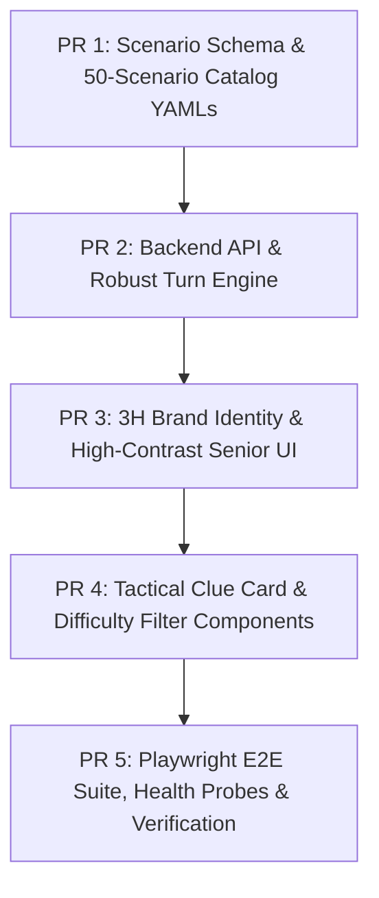

# 🥞 Stack PR Decomposition Plan: 3H Solutions Scenario Training Engine
**Standard**: Senior Engineering Standard ($\le 400$ LOC per Stack PR unit, Single Responsibility Principle)  
**Client**: Uzair | 3H Solutions Group  
**Tracking**: Autonomous Council Stage 1 -> Stage 2

---

## PR Stack Overview

---

### PR 1: Schema & 50-Scenario Production Catalog
- **Responsibility**: Authoritative scenario definitions (25 Leadership + 25 Sales) matching `specs/scenario-engine-v2.spec.md` and 160 leadership capabilities.
- **Components**:
  - `backend/app/schemas/scenarios.py`: Add `tactical_coaching_clue`, `target_capabilities`, `difficulty` constraints (1-5).
  - `backend/scenarios/leadership/*.yaml`: 25 leadership scenarios with balanced difficulty (5x L1, 5x L2, 5x L3, 5x L4, 5x L5).
  - `backend/scenarios/sales/*.yaml`: 25 enterprise sales scenarios with balanced difficulty (5x L1, 5x L2, 5x L3, 5x L4, 5x L5).
  - `backend/app/services/scenario_service.py`: Update YAML loader and validation parser.
- **Estimated LOC**: ~380 LOC (Modular scenario YAML generation script and schema updates).

---

### PR 2: Backend API & Robust Turn Engine
- **Responsibility**: Eliminate the single-turn cutoff bug, implement 25-turn/10-minute session limits, and update public API responses with zero credential leakage.
- **Components**:
  - `backend/app/ai/engine/conclusion_detector.py`: Replace over-eager regexes with explicit two-way conclusion consensus.
  - `backend/app/ai/engine/conversation_engine.py`: Enforce up to 25 exchanges, prevent premature timeouts, pass scenario-specific `tactical_coaching_clue`.
  - `backend/app/ai/providers/mock_provider.py`: Context-aware dynamic responses responding directly to trainee prompt instead of canned sales replies.
  - `backend/app/api/sessions.py` & `backend/app/api/scenarios.py`: Expose `tactical_coaching_clue`, `difficulty` level, and `target_capabilities` in `PublicScenarioDetail`.
- **Estimated LOC**: ~320 LOC.

---

### PR 3: Frontend 3H Brand Overhaul & Senior Accessibility UI
- **Responsibility**: Corporate visual identity for 3H Solutions Group (`#0B192C` navy, `#FF6500` corporate orange), 3H logo asset integration, typography legibility overhaul ($\ge 16\text{px}$ base font, $18\text{px}$ dialogue).
- **Components**:
  - `frontend/src/assets/3h-logo.svg`: Clean SVG corporate logo for 3H Solutions Group.
  - `frontend/src/index.css`: Navy/Orange design tokens, high-contrast WCAG AAA rules, custom scrollbars, typography scaling.
  - `frontend/src/components/Navbar.tsx`: Prominently feature 3H Solutions logo, title, and theme toggle.
  - `frontend/src/pages/LoginPage.tsx`: 3H branding, high-contrast inputs, accessibility labels.
- **Estimated LOC**: ~290 LOC.

---

### PR 4: Tactical Coaching Clue & Difficulty Badge Component Overhaul
- **Responsibility**: Address Uzair's Directives 3 & 4. Prominent high-contrast Tactical Coaching Clue card with modal drawer for senior leaders, plus 5-tier difficulty badges and filter tabs.
- **Components**:
  - `frontend/src/components/TacticalClueCard.tsx`: Dedicated component with `#FF6500` amber border, `#132B45` surface, 16px font, and full-screen modal expansion button (`#clue-expand-modal-btn`).
  - `frontend/src/components/DifficultyBadge.tsx`: Color-coded pip badges (Emerald L1, Cyan L2, Amber L3, Orange L4, Ruby L5).
  - `frontend/src/pages/ScenarioLibraryPage.tsx`: Filter tabs for Difficulty 1-5 and Track (Leadership / Sales).
  - `frontend/src/pages/SimulationChatPage.tsx`: Integrate `TacticalClueCard`, turn counter (`Turn X of 25`), and elapsed timer.
- **Estimated LOC**: ~350 LOC.

---

### PR 5: Playwright E2E Test Suite & Docker Readiness Probes
- **Responsibility**: Layer 1-3 verification harness, automated browser E2E test verifying full user journey, and pytest test suite.
- **Components**:
  - `backend/tests/test_scenarios_v2.py`: Pytest validating all 50 scenarios against Pydantic schema, difficulty distributions, and capability links.
  - `backend/tests/test_engine_turns.py`: Pytest validating 25-turn multi-exchange conversations without premature cutoff.
  - `frontend/tests/threeh_solutions_e2e.spec.ts`: Playwright test covering 3H branding, 50-scenario filtering, difficulty badge selection, tactical clue modal opening, and streaming simulation turn.
- **Estimated LOC**: ~310 LOC.
